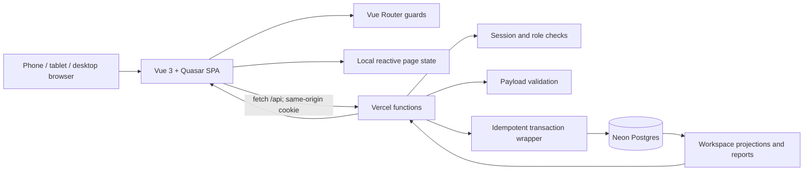
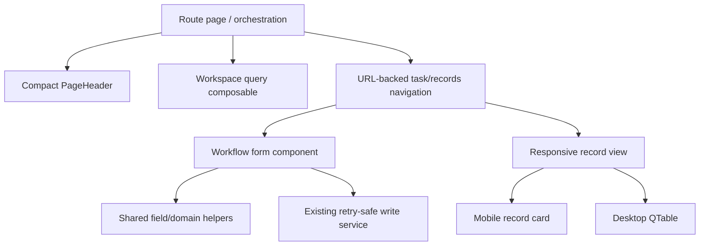

# BOMS application architecture and feature inventory

Audit date: 15 November 2026  
Status: read-only product audit; no application code changed

## Executive summary

BOMS is a Vue 3.5 and Quasar 2.23 single-page application built with the Quasar Vite CLI. It uses Composition API `<script setup>` throughout the active UI, Vue Router with hash history, route-level lazy loading, and local component state rather than Pinia or Vuex. Browser requests go only to same-repository Vercel functions under `/api`; those functions use cookie sessions, per-endpoint role checks, Zod-style server validation, idempotency keys, and Neon Postgres transactions.

The core business transaction design is strong: inventory and money writes are server-authoritative, retry-safe, role checked, and covered by database/domain tests. The main architectural risks are UI/API permission drift, unbounded workspace payloads, oversized page components, duplicated UI permission/formatting logic, and a lack of request caching, pagination, or query-level workflow state.

## Runtime map

Evidence: [quasar.config.js](../../quasar.config.js), [router/index.js](../../src/router/index.js), [lib/api.js](../../src/lib/api.js), [api/write.ts](../../api/write.ts), and [server/workspaces.ts](../../server/workspaces.ts).

## Framework and build

| Concern          | Observed implementation                                                                                   | Assessment                                                                    |
| ---------------- | --------------------------------------------------------------------------------------------------------- | ----------------------------------------------------------------------------- |
| Vue              | Vue 3.5; active components use Composition API and `<script setup>`                                       | Consistent                                                                    |
| Quasar           | Quasar 2.23; `@quasar/app-vite` 3.3                                                                       | Current project convention                                                    |
| Application mode | SPA build with hash routing; SSR/PWA/Capacitor sections are scaffold configuration only                   | Do not describe the current product as SSR, PWA, or native                    |
| Code splitting   | Every route layout/page is dynamically imported                                                           | Good route-level splitting                                                    |
| State            | Local `ref`/`reactive` state and a shared reactive auth/write service; no Pinia/Vuex                      | Adequate at current size, but cross-route drafts and cache state have no home |
| API              | `/api/*.ts` Vercel functions; same repo, no direct browser-to-database access                             | Good boundary                                                                 |
| Database         | Neon Postgres through `@neondatabase/serverless` and Drizzle/raw allowlisted SQL                          | Serverless-compatible                                                         |
| Styling          | Global SCSS, Quasar variables, scoped component CSS, utility color classes                                | Functional but token usage is incomplete                                      |
| Tests            | Node test runner, PGlite migrations/domain tests, Playwright browser tests, optional live Neon smoke test | Strong transaction coverage; responsive/a11y coverage needs expansion         |

Production build verification passed. The build emitted 481.52 KB total JavaScript and 216.80 KB total CSS before gzip; this is a baseline, not by itself a performance defect.

## Route and access inventory

| Route            | Page                   | Client route roles                                        | Server workspace roles                                              | Major capabilities                                    |
| ---------------- | ---------------------- | --------------------------------------------------------- | ------------------------------------------------------------------- | ----------------------------------------------------- |
| `/auth`          | `AuthPage.vue`         | Guest only                                                | Public login endpoint                                               | Sign in; self-registration disabled                   |
| `/`              | `IndexPage.vue`        | Any authenticated user                                    | All roles                                                           | Dashboard, weekly report, monthly review              |
| `/operations`    | `OperationsPage.vue`   | Owner, operations, production, warehouse                  | `SUPPLY`: all except sales/distribution                             | Receipts, production, supply/catalogue reference data |
| `/retail`        | `RetailPage.vue`       | Owner, operations, warehouse, sales/distribution, finance | `RETAIL`: all except production                                     | Finished stock, stock issues, retailer movements      |
| `/finance`       | `FinancePage.vue`      | Owner, operations, finance, read-only management          | `REVIEW`: owner, operations, sales/distribution, finance, read-only | Reconciliation, remittance, expenses, finance records |
| `/admin`         | `AdminPage.vue`        | Owner only                                                | Settings reads/writes also allow operations manager                 | Users, session status, roles, prices, recipes         |
| `/access-denied` | `UnauthorizedPage.vue` | Authenticated                                             | N/A                                                                 | Recovery from route denial                            |
| catch-all        | `ErrorNotFound.vue`    | Any                                                       | N/A                                                                 | 404 recovery                                          |

The client/server role differences are verified, not inferred. They may encode intentional read access, but there is no single documented permission matrix explaining the differences. In particular, operations managers are server-authorized to manage prices and recipes but cannot enter the owner-only `/admin` route that contains those controls. See MF-05 in the mobile UX audit.

## Layout and navigation architecture

`MainLayout.vue` uses `QLayout`, a fixed `QHeader`, a responsive `QDrawer` with a 1024 px breakpoint, and `QPageContainer`. Navigation items are filtered by duplicated client role arrays. At widths below 1024 px the drawer is the only global navigation; no bottom navigation is implemented. The mobile header shows the menu and brand but not the current page title. Desktop adds route context, role, user identity, and sign out.

The current model is structurally coherent, but page-level navigation is hidden inside long horizontal `QTabs` strips. Tab state is component-local and not encoded in the URL, so forms and records cannot be deep-linked, bookmarked, or restored after route destruction.

## Frontend module and component inventory

### Pages

| File                                        | Responsibility                                        | Size / risk                                            |
| ------------------------------------------- | ----------------------------------------------------- | ------------------------------------------------------ |
| `IndexPage.vue`                             | Dashboard calculations, trends, reports, review modes | 1,143 lines; many presentation calculations            |
| `OperationsPage.vue`                        | Purchase and production workflows plus records        | 1,463 lines; two complex write flows                   |
| `RetailPage.vue`                            | Stock issue and retailer inventory                    | 976 lines; one complex write flow                      |
| `FinancePage.vue`                           | Reconciliation, remittance, expense, histories        | 1,794 lines; three write flows and highest change risk |
| `AdminPage.vue`                             | User/catalogue settings composition                   | Small orchestrator                                     |
| `AuthPage.vue`                              | Sign-in experience                                    | Focused                                                |
| `UnauthorizedPage.vue`, `ErrorNotFound.vue` | Recovery states                                       | Focused, but heading semantics need repair             |
| `SecondPage.vue`                            | Unused scaffold                                       | Remove after confirming no external dependency         |

### Reusable components

| Component                               | Responsibility                                     | Recommendation                                               |
| --------------------------------------- | -------------------------------------------------- | ------------------------------------------------------------ |
| `WriteStatus.vue`                       | Persisted uncertain-write state and retry          | Keep; use as the standard mutation status pattern            |
| `AddPartnerButton.vue`                  | Supplier/retailer creation dialog                  | Keep, refine placement                                       |
| `PartnerProfiles.vue`                   | Search/edit/deactivate partners                    | Keep; split list/editor only if change pressure warrants     |
| `MaterialManager.vue`                   | Create/search/edit materials                       | Keep; move out of the primary task hero                      |
| `VariantManager.vue`                    | Create/search/edit variants/products               | Keep; move out of the primary task hero                      |
| `UserManagement.vue`                    | User lifecycle and access                          | Keep                                                         |
| `CatalogueSettings.vue`                 | Prices and production recipes                      | Keep; give operations managers an authorized route           |
| `BusinessReport.vue` / `ReportList.vue` | Period reports and responsive card/table rendering | Keep; this is the best existing responsive data-view pattern |
| `EssentialLink.vue`                     | Unused Quasar scaffold                             | Remove after dependency check                                |

## Data fetching, caching, and error behavior

- `apiRequest()` wraps `fetch`, includes same-origin credentials, applies a 30-second timeout, and normalizes network/incomplete/error responses.
- Each principal page fetches one workspace payload on mount and after successful writes.
- There is no client cache, stale-while-revalidate behavior, request deduplication, abort on route disposal, or pagination.
- Workspace SQL projections load complete historical tables and nested items, then pages render many arrays directly. This will degrade as operational history grows even though it is acceptable with seed data.
- Reports are date bounded to at most 32 days and use a sequence guard to ignore stale responses; workspace fetches do not use the same guard.
- Write retries are deliberately persisted per user/action in `sessionStorage` with the original idempotency key and body. This is a strong data-integrity feature and must be preserved.

## Authentication and authorization

Authentication uses an HttpOnly, Secure, SameSite=Lax `boms_session` cookie. Router initialization calls `/api/auth`; guest and protected routes are guarded before navigation. Server handlers independently load the session and call `requireRole()`, so client route checks are not the security boundary.

Write endpoints additionally require same-origin headers, a UUID idempotency key, a bounded request size, validation, and transactional database functions. Deactivation/password reset behavior is covered by tests. The audit found no evidence that business rules are enforced only in the browser.

## Forms, feedback, and transaction conventions

The six operational write forms use `QForm`, inline field rules, mobile input modes, disable/loading states, and server validation. Dates default to today; purchase/batch/issue/reconciliation forms support repeatable lines. Network-uncertain writes lock the action until the saved submission is retried or administratively checked.

Feedback is inconsistent: Operations also renders a page banner, while Retail and Finance rely mostly on `QNotify`; load errors use banners without a consistent live-region contract. Form drafts are not preserved for ordinary navigation or refresh.

## Data presentation inventory

There are no `QTable` instances in core operational workspaces. Purchases, batches, retailer movements, dispatches, reconciliations, remittances, and expenses are cards/lists at every viewport. `ReportList.vue` is the only responsive table strategy: cards below `md`, `QTable` at `md` and above. Management lists use searchable cards but no server pagination.

## Testing and build evidence

Executed on 15 November 2026:

- `npm run typecheck`: passed.
- `npm run test`: 7/7 domain, migration, user, partner, material, and variant tests passed.
- `npm run test:mobile`: 17/17 non-live browser tests passed; 1 live Neon smoke test skipped by design.
- `npm run build`: passed.
- `npm run lint:check`: failed because three pre-existing files are not formatter-clean: `api/debug-session.ts`, `tests/variants.test.mjs`, and the supplied `prompt-audit.md`.

The browser run also logged intermittent `ResizeObserver loop completed with undelivered notifications` development-server errors. They did not fail the suite, but should be investigated if they reproduce in production or user monitoring.

## Architectural inconsistencies

1. Permission rules are repeated across router metadata, layout navigation, page computed properties, components, and server constants; they already differ.
2. Workspace endpoints are broad aggregate reads with no cursor, date window, or record limit.
3. The four principal pages combine fetching, domain normalization, calculations, workflow state, validation, and presentation in files up to 1,794 lines.
4. Money/date/quantity formatting and role arrays are duplicated.
5. Tab state and record context are not represented in routes or query parameters.
6. Active pages are Composition API, but the repository description still says “Vue + TypeScript” while most frontend source is JavaScript; server/API code is TypeScript.
7. Unused scaffold files remain in the active source tree.

## Recommended target boundaries

Keep the current stack. Do not migrate frameworks or introduce a generic state library solely for fashion. Refactor along actual workflow boundaries:

Introduce only small shared modules with clear owners: formatters, role capabilities, workspace request state, `PageHeader`, `MetricStrip`, `RecordView`, and workflow-specific form components. Keep server transactions and API contracts unchanged during the UX iterations.
