# BOMS design system specification

Status: proposed refinement of the existing Quasar-based system

## Principles

1. Operational clarity before decoration.
2. One responsive component and business contract per workflow.
3. Quasar primitives first; custom components only for repeated BOMS semantics.
4. Visible state, validation, and recovery.
5. Mobile single-column baseline; progressive density at `md` and above.
6. WCAG 2.2 AA semantics and interaction by default.

## Foundations

### Color roles

Keep the Beecone warmth but expose semantic roles rather than direct palette utilities.

| Token                         | Purpose                                | Current source / direction                          |
| ----------------------------- | -------------------------------------- | --------------------------------------------------- |
| `--boms-color-primary`        | Primary action and active navigation   | Current cocoa/amber relationship; verify contrast   |
| `--boms-color-on-primary`     | Text/icon on primary                   | White or dark based on measured contrast            |
| `--boms-color-canvas`         | Application background                 | Simplify current layered gradients to a quiet cream |
| `--boms-color-surface`        | Primary content surface                | Opaque warm white                                   |
| `--boms-color-surface-subtle` | Rows, grouped fields, secondary panels | Light neutral cream                                 |
| `--boms-color-text`           | Main text                              | Current ink                                         |
| `--boms-color-text-muted`     | Secondary copy                         | Must pass 4.5:1 for normal text                     |
| `--boms-color-border`         | Dividers and input boundaries          | Neutral warm gray                                   |
| `--boms-color-success`        | Confirmed/saved/healthy                | Semantic green                                      |
| `--boms-color-warning`        | Attention/uncertain/low stock          | Amber with dark text                                |
| `--boms-color-danger`         | Destructive/error/expired              | Red with measured text pairing                      |
| `--boms-color-info`           | Informational/non-blocking             | Blue                                                |

Do not use color alone. Every status includes text and, where useful, an icon.

### Typography

Montserrat may remain if performance is acceptable. Use tabular numerals for quantities and money.

| Style                 | Target                                            |
| --------------------- | ------------------------------------------------- |
| Page title            | 28–32 px phone, 32–40 px desktop; `h1`            |
| Section title         | 20–24 px; `h2`                                    |
| Subsection/card title | 16–18 px; `h3` only when it improves navigation   |
| Body                  | 16 px phone, 15–16 px desktop; 1.5 line height    |
| Label                 | 13–14 px, medium/bold; avoid all-caps paragraphs  |
| Caption               | 12–13 px; never the only place for critical rules |
| Numeric value         | 18–28 px depending on hierarchy; tabular numerals |

### Spacing and shape

| Token              | Value | Use                                  |
| ------------------ | ----: | ------------------------------------ |
| `space-1`          |  4 px | Icon/text micro gap                  |
| `space-2`          |  8 px | Related controls                     |
| `space-3`          | 12 px | Row padding / compact cards          |
| `space-4`          | 16 px | Phone gutter / standard card padding |
| `space-6`          | 24 px | Section separation                   |
| `space-8`          | 32 px | Major desktop separation             |
| `radius-control`   |  8 px | Inputs/buttons                       |
| `radius-card`      | 12 px | Cards/rows                           |
| `radius-container` | 16 px | Major surfaces/dialogs               |

Remove the default 22×48 px shadow from routine surfaces. Use a border for ordinary cards, a small shadow for sticky chrome, and a stronger shadow only for modal overlays.

## Standard components

### PageHeader

- Semantic `h1`, optional one-line context, one primary action, overflow menu.
- Phone height should normally stay below 160 px including actions.
- No decorative gradient by default.

### AppNavigation

- Drawer owns the complete authorized tree.
- Optional bottom navigation owns at most four frequent destinations.
- Labels match route titles exactly: Dashboard, Operations, Distribution, Finance, Access & Settings.
- Active, hover, focus, and disabled states are visually and semantically distinct.

### TaskSelector

- Phone: compact select/segmented list grouped into “Do” and “Review.”
- Desktop: `QTabs` where all items fit.
- Selection is URL-backed and restores on reload/back.

### Button

| Variant       | Use                                                   |
| ------------- | ----------------------------------------------------- |
| Primary       | One page/form completion action                       |
| Secondary     | Important alternative or add-line action              |
| Tertiary/flat | Navigation, cancel, view detail                       |
| Destructive   | Deactivate/remove after clear scope; never color-only |
| Icon-only     | Only with accessible name and 44×44 px target         |

Avoid multiple primary-colored buttons in the same visual group. Loading buttons remain width-stable and disabled against duplicate submission.

### FormField and FormSection

- Labels remain visible; hints supplement rather than replace labels.
- Required state is announced; optional fields may be labeled optional when ambiguity matters.
- Errors appear directly under fields and in a form summary after submit.
- Related fields use a titled `fieldset`/legend or equivalent semantic grouping when appropriate.
- Date, numeric, email, telephone, and password autocomplete/input modes follow existing good patterns.

### RepeatableLineEditor

- Clear line number/title, remove action, business context, and per-line error summary.
- Phones stack fields; desktop uses a grid only when reading order stays logical.
- Duplicate selections are prevented or clearly aggregated.
- Reconciliation lines include an opening/accounted/unaccounted equation.

### FormActionBar

- Primary submit, compact computed totals, draft/retry state.
- Sticky only for long forms.
- Uses safe-area padding and does not cover the final field.
- Network-uncertain state delegates to the existing `WriteStatus` contract.

### StatusBadge

Approved vocabulary should be nouns/adjectives: Live, Loading, Unavailable, Active, Inactive, Low stock, Expiring, Expired, Payment due, Credit, Saved, Retry required. Do not use an action verb as a passive status.

### WorkspaceState

State machine:

```mermaid
stateDiagram-v2
  [*] --> Loading
  Loading --> Live: successful response
  Loading --> Unavailable: failed response
  Live --> Refreshing: manual refresh
  Refreshing --> Live: successful response
  Refreshing --> Live: failure; retain data + warning
  Unavailable --> Loading: retry
```

Each state has one visible label and one live-region message. Empty is a data state inside Live, not a synonym for Unavailable.

### ResponsiveRecordView

- Receives rows, stable row key, column/field definitions, actions, loading, empty, pagination, and filters.
- Mobile card labels remain visible; desktop table supports sort/filter/page.
- Selection/bulk actions appear only where the business workflow needs them.

### Dialog

- Phone maximized with title and close/back.
- Desktop bounded to content, with a reasonable maximum width/height.
- Dirty-state close confirmation only when needed.
- Focus moves inside on open and returns to the trigger on close.

### Notification and error summary

- `QNotify` is supplementary for brief confirmation.
- Blocking/error/retry states persist in the page or form.
- `role="alert"` for new blocking errors; `role="status"` for non-blocking progress/success.
- Avoid announcing the same message from both notify and banner.

## Responsive data rules

- Mobile cards show only fields required to identify status, amount/quantity, date, and next action; detail expands on demand.
- Desktop tables show comparison fields and expose filters without opening a dialog.
- Money is formatted consistently as UGX with zero decimal digits unless fractional currency becomes a real rule.
- Quantities always display their unit; “piece” should pluralize appropriately in final copy.
- Dates use Uganda locale/time semantics and distinguish date-only business dates from timestamps.

## Accessibility requirements

- One unique `h1` per route, coherent `h2`/`h3` structure.
- Visible focus indicator for every interactive element.
- 44×44 px minimum pointer target and 24 px minimum target spacing where controls are adjacent.
- Text contrast 4.5:1; large text/UI components at least 3:1 where applicable.
- Form errors identify the field and correction.
- `prefers-reduced-motion` disables nonessential animation.
- 200% text zoom must not cause two-dimensional page scrolling; 400% reflow is tested for critical tasks.
- Portrait and landscape supported without lost controls.
- Status and charts provide text equivalents.

## Component ownership and documentation

Every shared component documents:

- responsibility and non-responsibilities;
- variants and semantic use;
- required accessible name/heading behavior;
- loading, empty, error, disabled, focus, hover, active, and success states;
- phone/tablet/desktop composition;
- permission behavior;
- tests and examples.

The design system should live close to the implementation and be changed through real workflow migrations, not a separate all-at-once rewrite.
