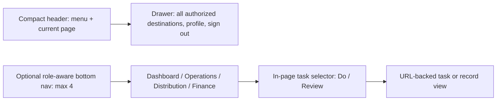

# Responsive design strategy

Audit date: 15 November 2026

## Strategy

Use one workflow and one data model at every size. Change composition, density, navigation persistence, and record presentation progressively. CSS should handle visual reflow; `$q.screen` should be reserved for behavior or rendering changes that cannot be expressed accessibly with CSS, such as selecting a mobile card renderer versus a desktop `QTable`.

## Reference widths and intended behavior

| Width | Layout intent          | Navigation                                                                             | Content and forms                                                                       |
| ----: | ---------------------- | -------------------------------------------------------------------------------------- | --------------------------------------------------------------------------------------- |
|   320 | Minimum viable phone   | Compact header; role-aware bottom destinations if approved; drawer for secondary items | 16 px gutter or less as needed; one column; no horizontal page overflow; short labels   |
|   375 | Primary phone baseline | Same as 320                                                                            | Primary action/task selector in first viewport; sticky safe-area submit                 |
|   430 | Comfortable phone      | Same as 375                                                                            | More inline summaries, never more required actions                                      |
|   768 | Tablet                 | Drawer overlay or collapsible rail; no bottom nav if width/context supports rail       | Two-column summaries; forms remain one column unless field relationships justify pairs  |
|  1024 | Small desktop          | Persistent/collapsible drawer                                                          | Desktop task tabs; two-column forms for related fields; record tables begin             |
|  1440 | Desktop                | Persistent navigation and contextual header                                            | Bounded content width; tables, filters, side summaries, and detail panels use the width |

These widths are test references, not new framework breakpoints. Align implementation primarily with Quasar `sm` (600) and `md` (1024), adding content-driven CSS only where the design actually breaks. Document any 768-specific rule rather than silently creating a second breakpoint system.

## Proposed navigation architecture

### Mobile



Recommended owner bottom destinations after validation: Dashboard, Operations, Distribution, Finance. Access & Settings remains in the drawer. Other roles see only their frequent authorized destinations; never fill empty slots or show disabled modules.

Within a module, replace the five-item scrolling phone tab strip with:

- a primary action at the page header;
- a compact “Task” selector for write forms;
- a “Review” selector for histories and snapshots;
- URL query state such as `/operations?view=receipt` or child routes if browser history semantics require it.

### Desktop

- Keep the persistent 280 px drawer initially; evaluate a 72 px collapsed rail only if field observation shows content pressure.
- Keep the current page title and role context, but remove redundant route/hero repetition.
- Use visible page-level primary and secondary actions; put rare catalogue/admin actions in an overflow.
- Use breadcrumbs only when deeper routes/detail pages are introduced. They add little value to the current one-level route tree.
- Consider split list/detail panels for partner/catalogue managers on 1024+ px, while phones retain list → full-screen editor.

## Page layout blueprint

```text
Mobile
┌─────────────────────────────┐
│ menu   Page title     status│
├─────────────────────────────┤
│ compact context + primary   │
│ task selector               │
│ exception / retry banner    │
│ form or mobile record cards │
│                             │
├─────────────────────────────┤
│ safe-area action bar        │
├─────────────────────────────┤
│ bottom navigation (optional)│
└─────────────────────────────┘

Desktop
┌────────────┬─────────────────────────────────────────────┐
│ drawer     │ title / context / actions                   │
│            ├─────────────────────────────────────────────┤
│            │ tabs or filter bar                          │
│            ├───────────────────────────────┬─────────────┤
│            │ table/form                    │ summary or  │
│            │                               │ detail pane │
└────────────┴───────────────────────────────┴─────────────┘
```

## Forms and keyboard behavior

- Phones use one column. Tablet/desktop may pair related fields: partner/date, reference/notes, category/date, amount/payee.
- Keep at least 16 px input text and 48 px field height.
- Numeric quantities use numeric/decimal input modes as already implemented; currency should remain decimal with server normalization.
- Sticky actions must use `padding-bottom: max(12px, env(safe-area-inset-bottom))` and must move above the virtual keyboard where supported.
- On submit failure, show a persistent error summary and focus the first invalid field.
- Preserve long-form drafts with a visible “Draft saved on this device” message; never persist passwords or server responses containing sensitive data.
- Use desktop select menus/search where efficient; retain dialog selection only on phones or for very large option sets where it improves scanning.

## Modal and manager behavior

| Size     | Partner/material/variant/user manager                                                |
| -------- | ------------------------------------------------------------------------------------ |
| <600     | Maximized dialog; top app bar with title/back/close; sticky safe-area save           |
| 600–1023 | Bounded dialog or full-page route based on form length; no clipped keyboard controls |
| ≥1024    | Split list/editor dialog or route; searchable list persists while editing            |

Persistent dialogs must warn before closing only when a dirty draft exists. A blanket `persistent` dialog without dirty-state semantics can trap users unnecessarily.

## Table-by-table responsive strategy

| Dataset                           | Mobile presentation                                                | Desktop presentation                                                     | Preserve                                    |
| --------------------------------- | ------------------------------------------------------------------ | ------------------------------------------------------------------------ | ------------------------------------------- |
| Open material lots                | Compact list grouped by material, exception-first                  | Sortable table with material, lot, supplier, received, remaining, cost   | Batch/lot traceability and quantity units   |
| Purchases                         | Receipt cards with reference, supplier, date, total; tap for lines | Paginated `QTable`, date/supplier/search filters; expandable line detail | Historical prices, lines, references        |
| Production batches                | Batch cards with variant, output, cost, date/expiry status         | Paginated `QTable`; filters by variant/date/expiry; detail drawer        | Inputs, output, cost, expiry                |
| Finished warehouse stock          | Batch cards, low/expiry status prominent                           | Table by batch/variant with quantity, unit cost, expiry                  | FIFO/batch identity                         |
| Retailer stock balances           | Retailer cards; expandable variant/batch lines                     | Grouped table or master/detail by retailer                               | Consignment ownership and movement totals   |
| Stock issues / dispatches         | Dispatch cards; tap for line detail                                | Paginated table with retailer/date/reference/quantity/value              | Batch lines and issue identity              |
| Retailer movements                | Compact chronological ledger cards                                 | Sortable/filterable ledger table                                         | Signed quantity, movement type, batch, cost |
| Open issue lines                  | Search-first select plus contextual line card                      | Table with selectable rows if bulk reconciliation is validated           | Open quantity and effective price           |
| Reconciliations                   | Retailer/date summary cards; expandable disposition                | Table with sold/returned/damaged/expired/remaining/liability             | Full accounting equation                    |
| Remittances                       | Receipt cards with retailer/date/amount/link                       | Table with filters, link status, outstanding context                     | Partial/multiple receipts                   |
| Expenses                          | Date/category/amount cards                                         | Paginated table with category/date/vendor filters                        | Historical amount and references            |
| Weekly/monthly reports            | Existing labeled cards and expansion sections                      | Existing `QTable` with sorting/pagination                                | Role-based redaction and period semantics   |
| Users/partners/materials/variants | Search-first cards; full-screen editor                             | Master table/list plus side editor                                       | Active/inactive history and permissions     |

Do not duplicate transformations or actions between card and table modes. `ReportList.vue` demonstrates the correct shared-data pattern, though its row key should use a stable business key where available rather than array index.

## Overflow and containment rules

1. `html`, `body`, and `#q-app` must not use global `overflow-x: hidden` as a substitute for fixing layout.
2. All grid/flex children that contain text or controls use `min-width: 0`.
3. Long references, email addresses, SKUs, and batch codes wrap or truncate with an accessible full value.
4. Only intentional scrollers—tables and tab strips on desktop—may overflow horizontally, with visible affordance and keyboard access.
5. The 320 px dashboard toggle defect must be fixed at the component, not masked on the document.

## Motion, orientation, and safe areas

- Disable `QTabPanels` animation and CSS transforms when `prefers-reduced-motion: reduce`.
- Test portrait and landscape at 320×568, 375×667, 430×932, and tablet landscape.
- Apply top/bottom safe-area insets to fixed/sticky chrome.
- Recompute available dialog height on orientation change and virtual keyboard appearance.

## Performance strategy

- Split initial summary/reference reads from paginated records.
- Return the minimum columns needed for list rows; fetch full nested lines on demand.
- Retain route lazy loading.
- Preserve previous successful data during manual refresh.
- Add request cancellation/sequence guards to workspace reads.
- Set budgets after measuring production-like data: payload size, route JS, CSS, LCP, INP, CLS, and time-to-first-action on a mid-range Android profile.
