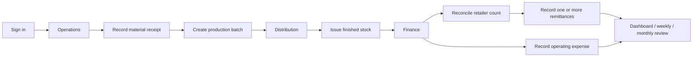
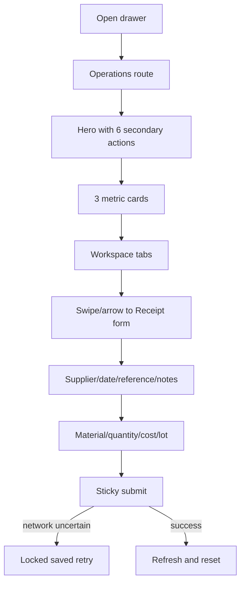
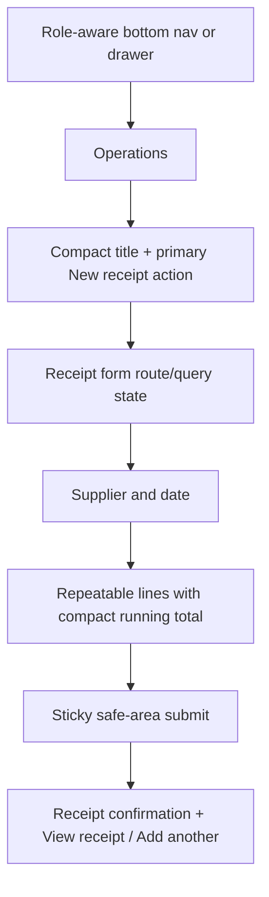

# Mobile-first user journey audit

Audit date: 15 November 2026  
Primary baseline: 375 px; minimum: 320 px

## Journey summary

All six core operational writes are present, validated, and browser-tested at 375 px. The dominant usability problem is not missing capability; it is the distance between entry and task completion. On mobile, users repeatedly pass a large decorative hero, secondary management actions, metric cards, and a partially visible tab strip before reaching the form. Long forms then depend on transient component state, so an accidental route change or refresh loses ordinary in-progress work.

## Current end-to-end operating journey

Business rules remain server-authoritative throughout: stock is batch-traceable; distribution is not a sale; reconciliation fully accounts for open stock; only sold units create liability; returns/damage/expiry are preserved; remittances remain separate and may be partial.

## Journey inventory

| Workflow             | Entry point                  | Goal and required information                                                   | Current sequence                                                                | Feedback / recovery                                           | Main friction                                                                                       |
| -------------------- | ---------------------------- | ------------------------------------------------------------------------------- | ------------------------------------------------------------------------------- | ------------------------------------------------------------- | --------------------------------------------------------------------------------------------------- |
| Sign in              | `/auth`                      | Email and password                                                              | Enter 2 fields, submit                                                          | Inline rules; server error banner; redirect by role           | Good phone form; no explicit password-recovery path                                                 |
| Global navigation    | Header menu                  | Reach an authorized workspace                                                   | Open drawer, choose workspace                                                   | Active item and access-denied route                           | Two taps; page title absent from mobile header; no bottom reach target                              |
| Purchase receipt     | Operations → Receipt form    | Supplier, date, one or more material/quantity/cost lines                        | Enter module, scroll to workspace, reveal tab, fill, submit                     | Inline rules, page banner, idempotent retry                   | Task starts 1,179 px down at 375 px; five-tab strip exposes only two tabs                           |
| Production batch     | Operations → Batch form      | Variant, date/code, output, optional expiry, input lots and quantities          | Same module path; select variant/output; recipe prefills; verify inputs; submit | Inline rules, cost estimate, stock checks, retry              | Hidden tab; long scroll; no draft persistence; expiry can remain unknown without a follow-up task   |
| Stock issue          | Distribution → Issue stock   | Retailer, date/reference, output batch and jars                                 | Enter module, scroll, reveal tab, fill, submit                                  | Inline rules, stock/value estimates, server concurrency check | Task starts 1,058 px down at 375 px; records and form share one tab strip                           |
| Reconciliation       | Finance → Reconciliation     | Retailer/date, open issue line, sold/returned/damaged/expired/remaining, reason | Select retailer/line; defaults remaining; account for all units; submit         | Inline rules, readonly price, totals, server rule enforcement | Highest data-entry load; hidden tab; no running “unaccounted units” value; draft loss risk          |
| Remittance           | Finance → Remittance         | Retailer, optional reconciliation, date, amount, reference                      | Select retailer, see outstanding, enter receipt, submit                         | Inline rules, outstanding chip, retry                         | Optional link semantics require knowledge; no warning when amount exceeds current outstanding in UI |
| Expense              | Finance → Expense            | Category, date, amount, vendor/reference/notes                                  | Fill and submit                                                                 | Inline rules, retry                                           | Free-text category creates consistency risk; form hidden in fifth-level module strip                |
| Add/manage partner   | Operations/Distribution hero | Contact and status details                                                      | Open persistent dialog, save, return selected                                   | Inline rules, retry, full-screen below 600 px                 | Secondary administration dominates the mobile hero                                                  |
| Add/manage catalogue | Operations hero / Admin      | Materials, variants, price, recipes                                             | Open dialogs or admin expansion panels                                          | Search/filter, validation, retry                              | Operations manager is API-authorized for price/recipe settings but blocked from `/admin`            |
| User access          | Admin                        | Create/edit/deactivate/reset                                                    | Search card list, dialog editor, save                                           | Server safeguards and audit tests                             | Owner-only and usable; long page lacks internal navigation                                          |
| Reports              | Dashboard toggle             | Weekly/monthly operating review                                                 | Switch mode, choose period, expand sections                                     | Loading bar, error retry; mobile cards and desktop table      | Dashboard control overflows at 320 px; report sections can be long                                  |

## Detailed mobile journeys

### 1. Purchase receipt

Current:

Proposed:

Retain the same fields, validation, idempotency key, and API payload. Move catalogue/partner management to an overflow or settings destination.

### 2. Production batch

Keep recipe defaults editable and preserve FIFO material selection. Make “unaccounted prerequisites” explicit before the user enters the form: no active variant, no open material stock, or missing recipe are distinct states. After a successful batch, show the generated batch code, output quantity, unit cost, and expiry status in a confirmation panel.

### 3. Stock issue

Prioritize retailer and batch selection, then display availability immediately adjacent to quantity. Disable already-selected output batches in additional lines or clearly aggregate duplicate selections. Success should offer “View dispatch” and “Issue more stock”; do not imply the issue is a finalized sale.

### 4. Reconciliation

This is the most cognitively demanding workflow. For each selected issue line, show:

- opening quantity;
- sold, returned, damaged, expired, and remaining inputs;
- a live `unaccounted = opening - entered` value;
- the price effective on the chosen reconciliation date;
- the resulting liability and inventory disposition.

Keep a single page on phones unless field testing shows multi-step completion is materially better. A forced wizard would make cross-line comparison harder. Preserve a local draft keyed by retailer and date, and warn before discarding it.

### 5. Remittance

After retailer selection, show outstanding balance and oldest open liabilities. Keep reconciliation linking optional, but explain whether an unlinked payment will be allocated oldest-first. If overpayment is valid as credit, state that before save; otherwise validate against outstanding. The database rule is the source of truth.

### 6. Reporting and follow-up

Turn watchlist statuses into clear nouns rather than action-like chips: for example, “Payment due” instead of “Collect.” Provide an actual adjacent action only to roles that can perform it. Preserve the existing role-sensitive report redaction.

## Action count and scroll assessment

Counts exclude typing and assume the user is already authenticated.

| Task                                     |      Current minimum navigation actions | Current vertical cost                    | Target                                            |
| ---------------------------------------- | --------------------------------------: | ---------------------------------------- | ------------------------------------------------- |
| Open purchase form from another module   |   Drawer + Operations + Receipt tab = 3 | Workspace begins 1,179 px down at 375 px | 2 actions and task above first viewport           |
| Open batch form from Operations snapshot |          Reveal/select Batch form = 1–2 | Same 1,179 px pre-task content           | 1 action; remember last task or use direct action |
| Open stock issue from another module     | Drawer + Distribution + Issue stock = 3 | Workspace begins 1,058 px down           | 2 actions                                         |
| Open reconciliation from Distribution    |   Finance link + Reconciliation tab = 2 | Workspace begins 1,144 px down           | 1–2 actions; preserve context/retailer where safe |
| Record expense from dashboard            | Drawer + Finance + reveal Expense = 3–4 | Fifth tab is off-screen on phone         | 2 actions                                         |

## Error, success, and recovery audit

| State                   | Current                                                       | Recommendation                                                    |
| ----------------------- | ------------------------------------------------------------- | ----------------------------------------------------------------- |
| Field validation        | Inline Quasar rules plus submit guards                        | Keep; add scroll/focus assertion in tests                         |
| Business-rule conflict  | Server message via banner or notify                           | Keep; attach message to form summary and preserve inputs          |
| Network-uncertain write | Persisted exact body/key, action locked, explicit retry       | Keep unchanged; this is a model pattern                           |
| Workspace load failure  | Empty/unavailable model and banner/error                      | Add skeleton/initial state; fix dashboard mode mismatch           |
| Success                 | Notify/banner, reset, refetch                                 | Add concise confirmation and next actions                         |
| Ordinary draft          | Component memory only                                         | Preserve long/critical drafts; warn before destructive navigation |
| Authentication expiry   | API returns 401, but request layer does not globally redirect | Define consistent re-auth flow that preserves a safe local draft  |

## Assumptions requiring field validation

- Which two or three destinations each role opens most often during a shift.
- Whether staff commonly reconcile multiple issue lines in one retailer visit.
- Whether expenses use a controlled category list in accounting practice.
- Whether over-remittance is valid retailer credit or should be blocked.
- Whether batch expiry may legitimately be unknown at production time.
- Whether users share devices; this affects how long non-sensitive drafts should remain in session storage.
